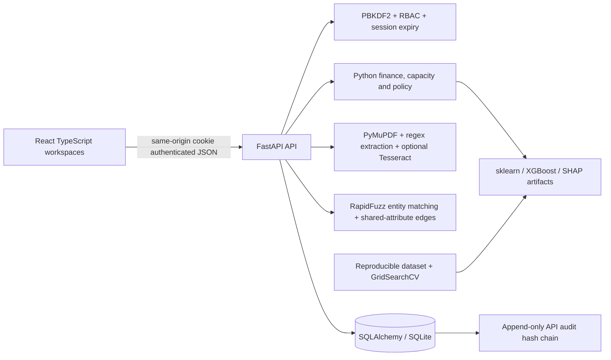

# Architecture

Backend is the authoritative calculator. Frontend displays stored or API-calculated results and handles navigation/form state. Vite builds static assets; FastAPI serves them with SPA route fallback. No external AI APIs. Offline system fonts are used. Database and uploads stay in ignored `data/`; trusted model artifacts in ignored `artifacts/`.

## Persistence and transactions

SQLAlchemy tables: users, sessions, customers, financial_profiles, applications, collateral, assessments, documents, extracted_fields, discrepancies, reviews, model_versions, audit_events, relationships, repayments, loan_structures, credit_reports, credit_accounts, loans, model_validation_notes. SQLite foreign keys are enabled. Identity/username/disbursement uniqueness constraints prevent duplicate identifiers or facilities. Pydantic enforces accepted value ranges, finite numerics, enum workflow states and extra-field rejection. Alembic revisions 001/002 apply the schema. JSON financial profiles and assessment results preserve evolving analytical payloads; entity links use foreign keys. Personal/business are explicit customer types with distinct financial inputs, not separate physical customer tables.

Every API request uses a transaction that commits on success and rolls back on error. Model training persists artifacts before registry commit; filesystem and DB are not distributed transactions. A crash between those operations can leave an unregistered artifact, documented as a local demo limitation. Single local server process is intended. Audit hash chaining is verified against the full stored sequence; it is not an externally anchored compliance ledger.

## Decision boundaries

Models recommend; humans decide. Assessments are versioned rows and retain model, feature vector, SHAP, reasons and financial outputs. Review rows point to the assessment and preserve original recommendation. Final approved/declined applications cannot be reassessed or receive another final decision. Updated borrower financial snapshots affect future assessments; old assessments remain intact. Financial profile values are current customer data; assessments preserve their own model inputs and results.

## Security

Passwords: PBKDF2-HMAC-SHA256, unique random salt, 600,000 rounds, constant-time verification. Random session bearer token is stored only as SHA256 in SQLite, sent in HttpOnly SameSite=Strict cookie, expires in eight hours. Loopback HTTP is the local deployment mode. CORS/origin allowlist protects browser mutations; login attempts rate-limited per address in memory. Viewer reads; analyst edits/intakes/assesses; reviewer additionally makes decisions and resolves flags; administrator trains, validates, activates and overrides. File allowlist, random storage names, 10 MB/50-page limits, PDF signature validation. No executable uploads. Joblib reads only locally created trusted model artifacts. Never accept user-provided model binaries.

## Future deployment

Use PostgreSQL with a supported driver (not installed here), HTTPS secure cookies, a production secret manager, scoped tenant access, external audit anchoring, malware scanning/OCR isolation, backups, model validation/fairness monitoring, job queues and load testing. Docker configuration is provided but not run because Docker is unavailable on this machine. Do not expose the local academic server publicly as-is.
